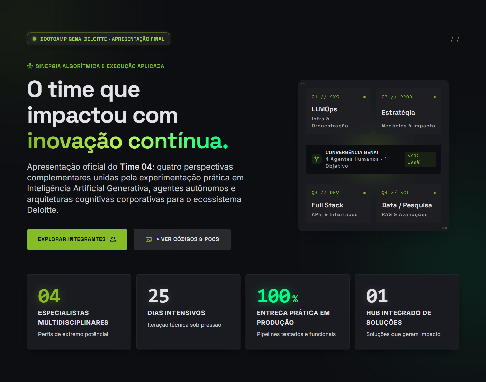
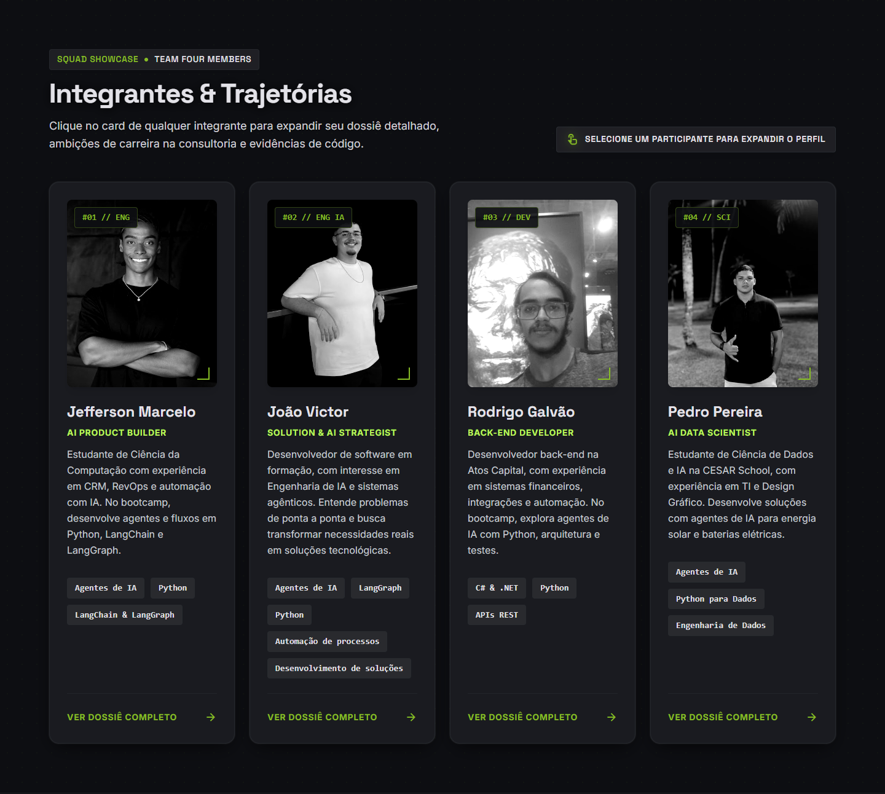
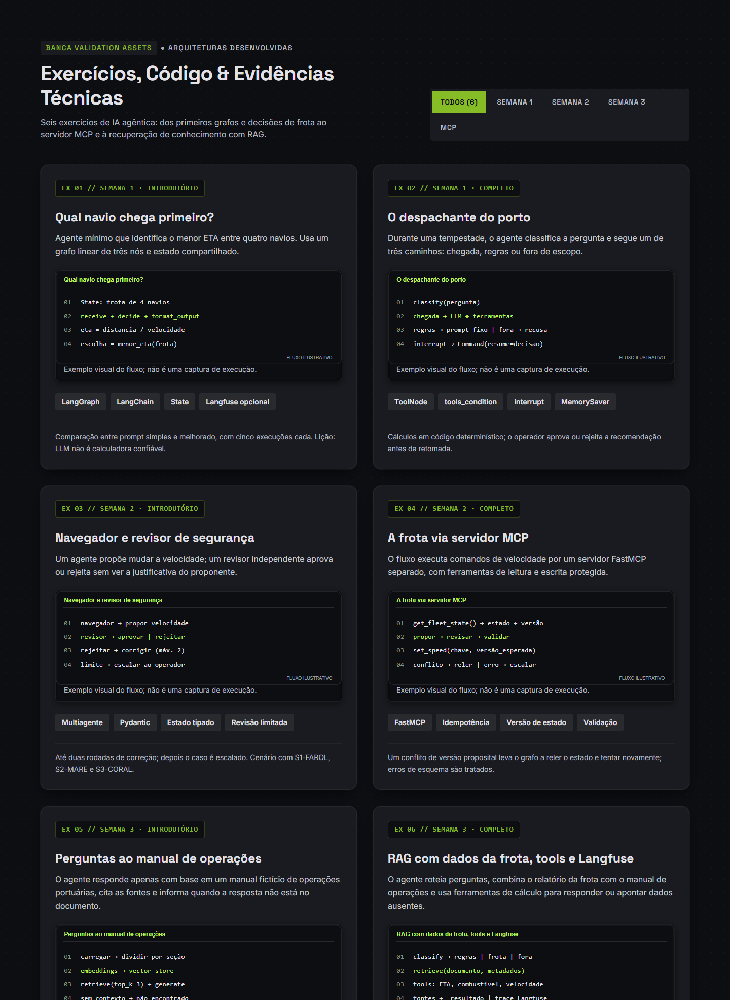
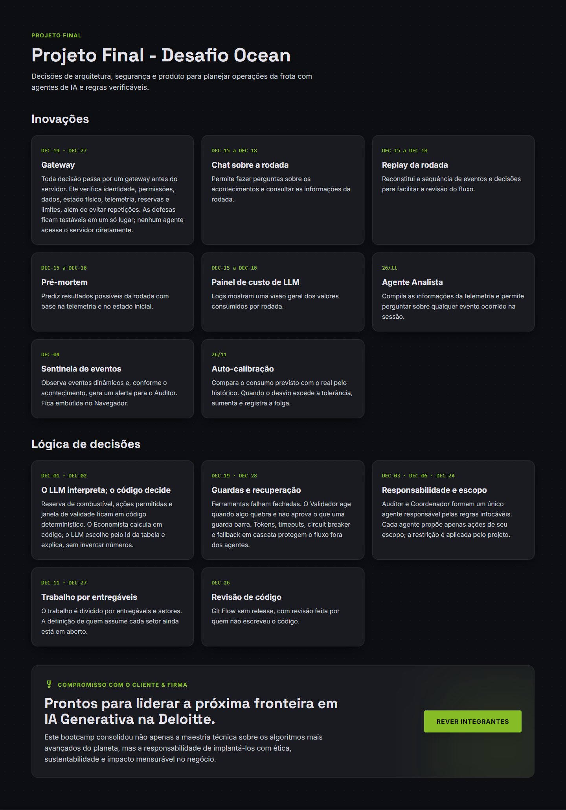

# Time 04 — Bootcamp GenAI

Landing page de apresentação do Time 04. O objetivo é reunir, em uma página, os integrantes, os exercícios do bootcamp e as decisões do projeto final **Desafio Ocean**. A navegação permite consultar os perfis individuais, acompanhar a evolução técnica das semanas e entender as escolhas de arquitetura e produto do grupo.

## Para entrar na landing page, Acesse:
### https://time04-genai.vercel.app/

## Visão das seções

### Início

Apresenta o time, o contexto do Bootcamp GenAI e os caminhos para conhecer os integrantes e os exercícios.

### Integrantes

Mostra os quatro integrantes com foto, área de atuação e resumo. Ao selecionar um card, a página abre o dossiê individual.

### Repositórios e entregáveis

Organiza seis exercícios por semana e tema, com descrições, tecnologias e ilustrações dos fluxos. As imagens de código são **representações visuais**, não capturas de uma execução real.

### Projeto Final — Desafio Ocean

Resume as inovações e a lógica de decisões para operações da frota, com referências às decisões `DEC`. O bloco final destaca o compromisso do time com soluções responsáveis e impacto no cliente.

## Abrir localmente

Abra [`index.html`](index.html) no navegador. A página é estática e não exige instalação de dependências. Fontes e algumas fotos são carregadas de serviços externos, então esses recursos podem depender de conexão com a internet.
